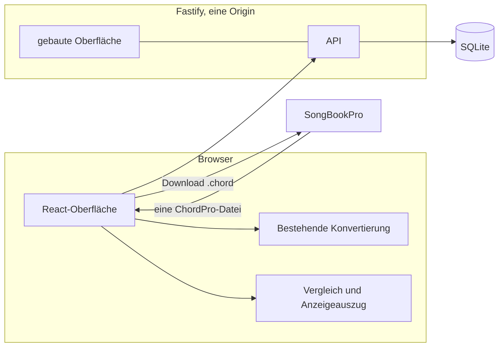

# Fachkonzept ChordPro Converter 2.0

Stand: 5. November 2026. Dieses Dokument ist die verbindliche fachliche Grundlage der ersten produktiven Version. Es setzt die bereits entschiedenen Vorgaben um und übernimmt den untersuchten Ist-Stand aus [V2_ANALYSIS.md](V2_ANALYSIS.md). Die Analyse bleibt unverändert die Beschreibung des Repository-Stands 1.1.0.

Wo dieses Konzept einen in der Analyse noch offenen Punkt festlegt, gilt das Konzept. Punkte, die hier als offene Frage stehen, sind nicht entschieden und dürfen bei der Umsetzung nicht durch eine eigene Annahme ersetzt werden.

## 1. Zweck

ChordPro Converter 2.0 erweitert den bestehenden Ultimate-Guitar-Konverter um eine zentrale Liedersammlung der Band Alpspitz Buam.

Die Anwendung konvertiert Lieder, speichert sie zentral, macht sie für die Band gemeinsam verwaltbar, stellt sie als ChordPro-Dateien bereit und übernimmt bearbeitete ChordPro-Dateien aus SongBookPro wieder in ein bestehendes Lied.

SongBookPro bleibt in dieser Version der Editor für bestehende Lieder und die Anwendung für deren musikalische Nutzung. CPC enthält dafür keinen eigenen Editor.

CPC ist kein vollständiger SongManager.

## 2. Zielbild

Der Browser konvertiert Ultimate-Guitar-Text, zeigt die Rückimport-Vorschau und sendet erst den bestätigten vollständigen ChordPro-Text an die API. Der Server prüft Konto, Berechtigung und Fassung und speichert den Text. Er formatiert gespeicherten ChordPro-Text nicht um.

## 3. Technische Rahmenbedingungen

Verbindlich sind:

- Das bestehende React/Vite-Frontend bleibt die Oberfläche.
- Die API läuft mit Node.js 24 LTS und Fastify.
- Die Datenhaltung ist eine SQLite-Datenbank.
- Der Betrieb erfolgt mit Docker Compose auf dem Ubuntu-Server unter `https://cpc.faustens.de`.
- Frontend und API liegen unter derselben Origin.
- Die Version hängt nicht von Nextcloud ab.
- Die vorhandene Ultimate-Guitar-Konvertierung wird weiterverwendet, soweit sie zu diesen Regeln passt.
- Die Bedienung ist auf Tablets ausgelegt, vorrangig Android, zusätzlich iPadOS.
- Umsetzung nach KISS und YAGNI: keine zusätzlichen Dienste, Bibliotheken oder Fähigkeiten, die diese Regeln nicht verlangen.

Die Konvertermodule unter `src/converter/` bleiben frameworkfrei. Neue reine Funktionen für Notationsabbildung, Textvergleich und das Auslesen von Anzeigewerten werden ebenso frameworkfrei gehalten, damit Oberfläche und Server dieselbe Regel ausführen.

Die Laufzeit ist Node.js 24 LTS. Entwicklung, CI und das Docker-Image verwenden diese Major-Version. Die CI verwendet Node.js 24 bereits. Das README nennt noch Node.js 22; diese Angabe wird bei der Umsetzung angeglichen.

## 4. ChordPro-Text als maßgebliche Quelle

Der vollständige ChordPro-Text ist die maßgebliche Quelle für den Liedinhalt.

Gespeichert und bei einem bestätigten Rückimport ersetzt wird dieser Text als Ganzes. Titel, Interpret, Tonart, Capo und andere musikalische Angaben werden nicht zusätzlich als fachliche Datenfelder geführt. Die Sammlung darf solche Angaben für die Anzeige aus dem Text lesen. Dieses Lesen verändert den gespeicherten Text nicht.

CPC muss Direktiven nicht verstehen, um sie zu behalten. Bekannte und unbekannte Direktiven bleiben vollständig erhalten. Die Anwendung bereinigt oder formatiert gespeicherten ChordPro-Text nicht automatisch.

Verwaltungsdaten sind von diesem Text getrennt:

| Verwaltungsdatum | Bedeutung |
| --- | --- |
| Lied-ID | stabile, eindeutige Identität; unabhängig vom Titel |
| Besitzer | Konto, das das Lied angelegt hat |
| Sichtbarkeit | `PRIVATE` oder `BAND` |
| Version | die jeweilige Textfassung |
| Änderungszeitpunkt | Zeitpunkt der letzten Verwaltungs- oder Textänderung |
| Löschzustand | ob das Lied aus der aktiven Sammlung genommen wurde |

Der Besitzer ändert sich in dieser Version nicht. Ein Sichtbarkeitswechsel überträgt das Lied nicht an ein anderes Konto und erzeugt keine Kopie.

Die Lied-ID wird nicht in den ChordPro-Text geschrieben. Eine solche Direktive ist nicht entschieden und ihr Erhalt durch SongBookPro ist nicht belegt.

Für die Liste liest die Anwendung Anzeigewerte aus einfachen Direktivenzeilen der Form `{title: ...}` und `{artist: ...}`, wie der bestehende Konverter sie schreibt. Fehlt der Titel, bleibt das Lied über seine ID auffindbar. Andere Schreibweisen bleiben im Text erhalten. Sie werden für die Anzeige erst gelesen, wenn ihre Gleichwertigkeit belegt ist.

## 5. Akkordnotation

Speicherung und Export verwenden ausschließlich die internationale Akkordnotation. Eine Einstellung für deutsche Akkordnamen gibt es in CPC nicht. Eine zusätzliche Einstellung zur Auswahl der Eingabenotation gibt es in dieser Version ebenfalls nicht. SongBookPro stellt die Namen nach seinen eigenen Einstellungen dar.

| Deutsche Quelle | Internationale Speicherung und Export |
| --- | --- |
| `H` | `B` |
| `B` | `Bb` |
| `Hm` | `Bm` |
| `Bm` | `Bbm` |

Dieselbe Abbildung gilt für Grundton und Basston eines Slash-Akkords und für Tonartangaben, wenn diese Quelle als deutsch belegt ist: `{key: H}` wird `{key: B}`, `{key: Hm}` wird `{key: Bm}`, `{key: B}` wird `{key: Bb}`, `{key: Bm}` wird `{key: Bbm}`. Suffixe bleiben am umgeschriebenen Grundton, also `H7` als `B7` und `Hm7` als `Bm7`.

Die Umwandlung erfolgt beim Eingang und ist kontextabhängig. Sie darf bereits internationale Akkorde nicht beschädigen. Ein bereits internationales `B` darf nicht zu `Bb` werden, ein vorhandenes `Bb` nicht zu `Bbb`. Eine automatische, zweifelsfreie Erkennung der Herkunftsnotation ist nicht vorgesehen und darf nicht vorausgesetzt werden. Daraus wird keine Erkennungsregel gebaut, auch nicht die Annahme, ein irgendwo vorkommendes `H` mache die übrigen Tonbuchstaben derselben Quelle deutsch.

`H` kommt in der internationalen Notation nicht vor. Ein Grundton oder Basston `H` ist deshalb für sich genommen eindeutig deutsch und wird abgebildet, einschließlich Suffix und Slash-Seite.

`B`, `Bm` und `Bb` sind ohne belegten deutschen Herkunftskontext mehrdeutig. `B` kann internationales `B` oder deutsches `B` sein, `Bm` entsprechend internationales `Bm` oder deutsches `Bm`. Solange dieser Kontext für den jeweiligen Eingang nicht belegt ist, bleiben `B`, `Bm`, `Bb` und ihre Suffixe unverändert. Die Tabellenzeilen `B` → `Bb` und `Bm` → `Bbm` gelten nur für einen Eingang, dessen deutsche Notation belegt ist.

Der bestehende Ultimate-Guitar-Konverter ist ein solcher Eingang. Für ihn ist nicht belegt, dass die Quelle insgesamt deutsch notiert ist. Seine Eingabe bleibt möglichst unverändert: `H`, `B` und `Bb` bleiben zulässige Eingaben. Die Ausgabe schreibt eindeutiges `H` international und lässt mehrdeutiges `B`, `Bm` und `Bb` stehen. Ein als deutsches `B` gemeinter, aber als `B` eingegebener Tonbuchstabe wird dadurch als internationales `B` gespeichert. Das ist die verbleibende Einschränkung dieser Version, keine zusätzliche Funktion.

Der heutige Code lässt `H` als Grundton zu und schreibt erkannte Tonbuchstaben unverändert weiter, einschließlich `{key: H}`. Die Abbildung des eindeutigen `H` ist noch nicht implementiert.

Ein Einzelimport wendet dieselbe Einschränkung an. ChordPro-Dateien des heutigen Converters enthalten deutsches `H` und ein unverändert durchgereichtes `B`. Ein darin vorkommendes `H` belegt die übrigen `B` nicht als deutsch. Ein Rückimport aus SongBookPro wendet die Tabelle einschließlich `B` → `Bb` nur an, wenn die Exportprobe belegt, dass diese Dateien deutsch notiert sind. Andernfalls bleibt der bestätigte Dateitext in seiner Notation erhalten. Die Probe legt keine Erkennungsregel für andere Quellen fest.

## 6. Abschnitte

Die bestehende Zuordnung in `labelToDirective()` bleibt.

| Label am Anfang, ohne Berücksichtigung der Groß-/Kleinschreibung | Direktive |
| --- | --- |
| `chorus`, `refrain` | `{soc: <vollständiges Label>}` |
| `verse`, `strophe`, `vers` | `{sov: <vollständiges Label>}` |
| jedes andere Label, auch `Intro`, `Bridge`, `Solo`, `Pre-Chorus` | `{c: <vollständiges Label>}` |

Deutsche Bezeichnungen wie `Strophe` und `Refrain` bleiben zulässig. `{sov: ...}` und `{soc: ...}` sind für diesen Anwendungsfall mit SongBookPro praktisch bestätigt. Abschließende `{eov}`- und `{eoc}`-Direktiven werden nicht erzeugt und sind hier nicht erforderlich.

Eine Inventarliste der in der Sammlung vorkommenden Abschnitte ist für diese Regeln nicht erforderlich.

## 7. Konten und Sitzungen

Jedes Bandmitglied hat ein persönliches Konto. Es gibt keine Selbstregistrierung und keine E-Mail-Adresse. Weitere Benutzerkonten legt ausschließlich der Administrator an und teilt das Passwort außerhalb der Anwendung mit.

Beim ersten Start wird ein einmaliger Einrichtungsdialog angeboten. Die Ersteinrichtung ist nur möglich, solange noch kein Administratorkonto existiert. Sie muss gegen unbefugte Nutzung geschützt sein. Dafür ist ein einmaliges Setup-Token vorgesehen, das der Betreiber außerhalb der öffentlichen Seite bereithält. Das Token ist nicht Bestandteil der ausgelieferten Oberfläche. Die konkrete Prüfung des Tokens ist Aufgabe der Umsetzung und im Implementierungsplan beschrieben. Eine ungeschützte öffentliche Einrichtung ist ausgeschlossen. Nach erfolgreicher Einrichtung ist der Dialog nicht mehr verfügbar, und eine erneute Ersteinrichtung ist ausgeschlossen. Das dabei angelegte Konto ist das Administratorkonto.

Jedes angelegte Konto ist ein Bandmitglied. Das Administratorrecht ist ein zusätzliches Recht zur Kontoverwaltung. Es erweitert die Sicht auf Lieder nicht: ein privates Lied bleibt für den Besitzer allein sichtbar.

Benutzernamen sind ohne Unterscheidung von Groß- und Kleinschreibung eindeutig. `Joshi`, `joshi` und `JOSHI` bezeichnen dasselbe Konto. Gespeichert und angezeigt wird die beim Anlegen verwendete Schreibweise. Die Anmeldung vergleicht den Benutzernamen ebenfalls ohne Unterscheidung der Groß- und Kleinschreibung.

Die Anmeldung erfolgt mit Benutzername und Passwort. Passwörter werden nur als Hash gespeichert. Ein leeres Passwort ist keine gültige Anmeldung. Ein deaktiviertes Konto kann sich nicht anmelden.

Die Sitzung liegt serverseitig, ist widerrufbar und wird als HTTP-only-Cookie geführt. Das Cookie ist für die gemeinsame Origin bestimmt, mit `SameSite=Strict`, und im HTTPS-Betrieb mit `Secure`. Der Benutzer bleibt angemeldet, bis er sich abmeldet oder die Sitzung widerrufen wird. Eine fachliche Ablaufzeit ist nicht vorgesehen.

Diese Vorgänge widerrufen die bestehenden Sitzungen des betroffenen Kontos:

- Abmelden widerruft die verwendete Sitzung.
- Ändern des eigenen Passworts widerruft die Sitzungen dieses Kontos.
- Zurücksetzen des Passworts durch den Administrator widerruft die Sitzungen dieses Kontos.
- Deaktivieren des Kontos widerruft die Sitzungen dieses Kontos.

Der Administrator darf Konten deaktivieren und wieder aktivieren. Deaktivieren und Zurücksetzen des Passworts sind getrennte Funktionen. Deaktivieren löscht das Konto nicht. Lieder und Versionshistorien bleiben erhalten. Besitzer und Sichtbarkeit ändern sich dadurch nicht. Wiederaktivieren macht die Anmeldung mit dem bestehenden Passwort wieder möglich. Es setzt kein Passwort zurück und stellt keine zuvor widerrufene Sitzung wieder her.

Beim Zurücksetzen vergibt der Administrator ein temporäres Passwort. Der Server kennzeichnet das Konto so, dass der nächste Login dieses Passwort ändern muss. Diese eingeschränkte Sitzung erlaubt nur die Passwortänderung. Danach sind ihre Sitzungen widerrufen, und der Benutzer meldet sich mit dem neuen Passwort an.

## 8. Liedersammlung und Berechtigungen

Jedes Lied hat eine eindeutige interne ID. Dieselbe Titelzeile darf bei mehreren Liedern vorkommen. Die ID unterscheidet sie.

| Sichtbarkeit | Zugriff |
| --- | --- |
| `PRIVATE` | Nur der Besitzer darf das Lied sehen und bearbeiten. |
| `BAND` | Jedes Bandmitglied darf das Lied sehen, bearbeiten, exportieren und löschen. |

Jedes Bandmitglied darf Lieder anlegen und legt dabei die Sichtbarkeit fest. Ein Lied kann zwischen `PRIVATE` und `BAND` wechseln. Der Wechsel erzeugt keine Kopie. Wer den Wechsel auslösen darf, ist Frage 1.

Bearbeiten bedeutet in dieser Version: den vollständigen ChordPro-Text durch einen bestätigten Import oder eine wiederhergestellte Fassung ersetzen, die Sichtbarkeit im entschiedenen Umfang wechseln und das Lied im entschiedenen Umfang löschen oder zurückholen. Ein Texteditor für bestehende Lieder gehört nicht dazu.

Löschen ist ein Soft-Delete. Vorher ist eine Bestätigung erforderlich, die das Lied anhand seiner ID und, soweit vorhanden, seines Titels nennt. Gelöschte Lieder verschwinden aus der aktiven Liste. Ihre Fassungen bleiben erhalten. Eine automatische endgültige Löschung gibt es nicht. Eine Funktion zum endgültigen Entfernen gibt es in dieser Version ebenfalls nicht.

Alle Bandmitglieder dürfen gemeinsame Lieder löschen und aus diesem Löschzustand wiederherstellen. Ob der Besitzer private Lieder löschen und wiederherstellen darf, ist Frage 2. Der Löschzustand eines Liedes, für das jemand kein Recht hat, bleibt für diese Person unsichtbar.

Exportieren eines privaten Liedes steht dem Besitzer zu, weil er das Lied sehen darf. Exportieren eines Bandliedes steht jedem Bandmitglied zu.

## 9. Versionen und Konflikte

Jede tatsächliche Änderung des ChordPro-Textes erzeugt eine neue Version. Die erste Speicherung legt die erste Version an. Alle Versionen bleiben dauerhaft erhalten. Jede Version trägt den Zeitpunkt und den verantwortlichen Benutzer.

Eine frühere Version kann wiederhergestellt werden. Die Wiederherstellung übernimmt deren ChordPro-Text unverändert in eine neue Version. Verantwortlicher Benutzer ist das Konto, das die Wiederherstellung auslöst. Für private Lieder darf das der Besitzer. Für Bandlieder darf das jedes Bandmitglied.

Gleichzeitige Änderungen werden mit optimistischem Locking erkannt. Der Client sendet die Fassung, die er zuletzt gelesen hat. Weicht die aktuelle Fassung davon ab, speichert der Server nichts und meldet den Konflikt. Es gibt keine stille Übernahme einer älteren Fassung und keine automatische Zusammenführung. Dieselbe Prüfung gilt für jede Änderung, die eine vorhandene Fassung überschreiben würde, also für Rückimport und Wiederherstellung einer Version.

Ob ein reiner Sichtbarkeitswechsel oder ein Soft-Delete zusätzlich eine Textversion erzeugt, ist Frage 3. Beide Vorgänge aktualisieren in jedem Fall den Änderungszeitpunkt und den verantwortlichen Benutzer der Verwaltungsänderung.

## 10. Konvertierung

Der laufende Weg ist `src/converter/convertToChordPro.js` mit `chords.js` und `sections.js`. Die Oberfläche verwendet diesen Weg weiterhin, um aus Metadaten und Ultimate-Guitar-ähnlichem Rohtext einen ChordPro-Text zu erzeugen und ihn als neues Lied zu speichern.

Weiterverwendet werden:

- Erkennung von Akkordzeilen und positionsbezogene Zusammenführung von Akkord und Text
- Ausgabe als Inline-Akkorde in eckigen Klammern
- `parseLabeledLine()` und `labelToDirective()`
- die bestehenden Kopffelder Titel, Interpret, Capo und Tonart als Direktiven im erzeugten Text

Die Ausgabe der Tonbuchstaben folgt Abschnitt 5. Die Eingabe des bestehenden Ultimate-Guitar-Konverters bleibt dabei möglichst unverändert. Die Abschnittsdirektiven bleiben.

`src/convertToChordPro.js` gehört nicht zum Laufzeitpfad. Tests und Änderungen beziehen sich auf `src/converter/`.

Für das bestehende Konverterformular gelten bis zu einer ausdrücklichen anderen Entscheidung die heutigen Grenzen: Titel und Interpret höchstens 30 Zeichen, Capo wird nur für die Werte 1 bis 11 in die Direktive geschrieben. Diese Grenzen sind Eigenschaften des Formulars und der Erzeugung. Sie sind keine zweite Speicherung neben dem ChordPro-Text. Ein später importierter Text wird daran nicht gekürzt oder von seinem Capo-Wert befreit. Fragen 4 und 5 halten fest, dass eine Erweiterung dieser Formulargrenzen nicht entschieden ist.

Bekannte Kanten des Konverters bleiben außerhalb dieser Version, solange sie nicht eigens beauftragt werden. Dazu gehören ein über eine Abschnittszeile hinweg offen bleibender Akkordpuffer, die Ausgabe `[|]` für einen Taktstrich, ein mögliches verbleibendes `\r` in einer zusammengeführten Zeile und fehlendes Escaping von `}` im Titel. Sie sind in der Analyse belegt.

## 11. Export

Ein gespeichertes Lied wird als einzelne ChordPro-Datei mit der Endung `.chord` heruntergeladen. Der Dateiinhalt ist der gespeicherte ChordPro-Text, ohne Umformatierung.

Der Dateiname folgt der bestehenden Bereinigung: unzulässige Zeichen `/ \ : * ? " < > |` werden zu `_`. Der Titel kommt aus dem gespeicherten Text. Fehlt er, heißt die Datei `chordpro_file.chord`.

Der Download muss auf Android und auf iPadOS geprüft werden. Der heutige Blob-Download ist dort nicht nachgewiesen. Eine direkte Übergabe an SongBookPro wird nur aufgenommen, wenn sie auf den Referenzgeräten ohne proprietäre SongBookPro-Schnittstelle tatsächlich funktioniert. Die erste Version setzt eine solche Übergabe nicht voraus. Der normale Weg ist die heruntergeladene `.chord`-Datei.

Der Export aus dem noch nicht gespeicherten Konverterergebnis bleibt erhalten, damit sich ein Text vor dem Anlegen prüfen und lokal sichern lässt.

## 12. Rückimport

### 12.1 Abhängigkeit vom SongBookPro-Export

Das tatsächliche ChordPro-Exportformat von SongBookPro ist nicht abschließend untersucht. Herstellerdoku und praktische Beobachtungen belegen nicht die konkrete Direktivenform, die Notation, die Leerzeilen und die Unterschiede zwischen Android und iPadOS sowie zwischen den Editorarten „Chords over Lyrics“ und „ChordPro“. Die Herstellerdoku weist außerdem darauf hin, dass ein ChordPro-Export Angaben verlieren kann.

Deshalb werden in diesem Konzept keine Exportstruktur und keine darüber hinausgehenden Importregeln festgelegt. Parser, Feldzuordnung und stille Normalisierung dürfen erst aus einer echten Exportdatei der von der Band genutzten SongBookPro-Version abgeleitet werden. Diese Datei ist eine Voraussetzung der Rückimport-Umsetzung, siehe Frage 6 und Frage 7. Die Prüfaufgabe P1 ist abgeschlossen, bevor die Rückimport-Implementierung beginnt.

### 12.2 Verbindlicher Ablauf

Ein Importvorgang verarbeitet zunächst genau eine ChordPro-Datei.

Der Ablauf:

1. Die Datei wird vollständig gelesen.
2. Die Anwendung ordnet sie einem bestehenden Lied zu, wenn die Zuordnung eindeutig ist.
3. Ist die Zuordnung unklar, entscheidet der Benutzer. Ohne diese Entscheidung wird nichts gespeichert.
4. Die Anwendung zeigt die Änderungen in einer verständlichen Vorschau. Die Vorschau nennt das Ziel-Lied mit ID und verfügbarem Titel und zeigt die inhaltlich abweichenden Zeilen.
5. Der Benutzer bestätigt ausdrücklich oder bricht ab.
6. Erst die Bestätigung sendet den vollständigen ChordPro-Text.
7. Der Server prüft Berechtigung, Fassung und den inhaltlichen Vergleich erneut.

Bei Abbruch bleibt das gespeicherte Lied unverändert. Es gibt keine zusätzliche Administratorfreigabe.

Der bestätigte Text ersetzt den bisherigen ChordPro-Text vollständig. Einzelne Felder werden nicht selektiv zusammengeführt. Unbekannte Direktiven bleiben vollständig erhalten. Eine Änderung an einer unbekannten Direktive ist eine inhaltliche Änderung.

Liegt nach dem Vergleich keine inhaltliche Änderung vor, entsteht keine neue Version. Der gespeicherte Text bleibt bytegenau unverändert, auch wenn sich die verglichene Darstellung technisch normalisieren ließe.

### 12.3 Vergleich

Der Vergleich dient nur der Entscheidung, ob eine neue Version entsteht, und der Vorschau. Er schreibt keine normalisierte Fassung zurück.

Beim Vergleich dürfen ausschließlich diese technischen Unterschiede ignoriert werden:

- unterschiedliche Zeilenenden
- Leerzeichen am Zeilenende

Leerzeilen sind zunächst mögliche inhaltliche Änderungen und werden nicht ignoriert.

Gleichwertige Direktiven-Schreibweisen werden nur ignoriert, wenn ihre Gleichwertigkeit eindeutig belegt ist. Derzeit ist keine Schreibweise für diesen Vergleich als gleichwertig freigegeben. Ein Beleg kann später aufgenommen werden. Bis dahin bleibt jede abweichende Schreibweise eine inhaltliche Änderung.

Nicht ignoriert werden insbesondere führende Leerzeichen, die Reihenfolge von Zeilen und Direktiven, Akkordschreibweisen, Groß-/Kleinschreibung und der übrige Text.

Eine Datei, die sich nicht als genau ein Lied behandeln lässt, wird vollständig abgelehnt. Nichts daraus wird teilweise gespeichert. Woran mehrere Lieder in einer Datei zu erkennen sind, hängt am offenen Exportformat und ist Frage 8.

Die Zuordnung auf ein bestehendes Lied kann sich nicht auf eine ID im Dateitext stützen, weil CPC keine solche ID hineinschreibt. Titel sind nicht eindeutig. Welche Signale eine automatische Zuordnung trotzdem eindeutig machen, ist Frage 7 und darf vor der Exportprobe nicht erfunden werden. Unklare Fälle enden bei der Entscheidung des Benutzers.

Weil der gesamte Dateitext die neue Fassung wird, zeigt die Vorschau auch Verluste, die bereits durch den Export in SongBookPro entstanden sind. Bestätigt der Benutzer diese Vorschau, wird genau dieser Dateitext gespeichert.

## 13. Einzelimport einer vorhandenen Datei

Vorhandene ChordPro-Dateien werden nicht aus Nextcloud migriert. Eine einzelne ChordPro-Datei kann als neues Lied importiert werden. Dabei gelten Abschnitt 5, der vollständige Erhalt des Textes und die Bestätigung vor dem Speichern.

Dieser Erstimport legt ein neues Lied mit neuer ID an. Er ist kein Rückimport und ersetzt kein bestehendes Lied. Der Benutzer legt die Sichtbarkeit fest. Bricht er ab, entsteht kein Lied.

Der Mehrfachimport mehrerer Dateien gehört nicht zur ersten Version. Er bleibt eine spätere Erweiterung.

## 14. Oberfläche

Die Oberfläche bleibt eine React-Anwendung mit der vorhandenen Bootstrap-Grundlage. Für die wenigen Ansichten wird keine zusätzliche Router-Bibliothek eingeführt.

Solange kein Administratorkonto existiert, bietet die Anwendung den Einrichtungsdialog an. Danach erreichen angemeldete Benutzer:

- die Liedliste mit ID, aus dem Text gelesenem Titel und Interpret, Sichtbarkeit, Besitzer und Änderungszeitpunkt
- die schreibgeschützte Ansicht eines Liedes und seiner Versionen
- den bestehenden Konverter, dessen Ergebnis als neues Lied gespeichert werden kann
- Export, Einzelimport und Rückimport
- Abmelden und Ändern des eigenen Passworts

Der Administrator erreicht zusätzlich die Kontoverwaltung. Dazu gehören Anlegen, Deaktivieren, Wiederaktivieren und das davon getrennte Zurücksetzen eines Passworts.

Die neuen Vorgänge mit Bestätigung oder Konfliktmeldung verwenden Dialoge in der Seite, die mit dem Finger bedienbar sind. Aktionen hängen nicht von einem Hover-Zustand ab. Die Liste und die Liedansicht bleiben im Hochformat eines Tablets nutzbar.

Eine Suche über die Sammlung, Setlisten und eine Volltextverwaltung sind nicht Teil dieser Version.

## 15. Sicherung

Einmal täglich entsteht automatisch eine Sicherung der SQLite-Datenbank. Aufbewahrt werden die letzten 30 erfolgreichen Tagesstände. Eine neue Sicherung des laufenden Tages ersetzt den bisherigen Stand dieses Tages erst nach erfolgreichem Abschluss. Ein fehlgeschlagener Lauf löscht keine vorhandene Sicherung.

Die Sicherungsdateien liegen persistent außerhalb des Container-Dateisystems. Die Sicherung einer laufenden Datenbank erfolgt über die Online-Backup-Schnittstelle von SQLite. Das Kopieren der gerade geöffneten Datenbankdatei erfüllt diese Anforderung nicht.

Das Wiederherstellungsverfahren wird dokumentiert und an einer Kopie geprüft. Der fachliche Ablauf ist: Anwendung anhalten, Datenbankdatei durch die gewählte Sicherung ersetzen, Anwendung starten, ein bekanntes Lied lesen und anschließend eine Schreibprüfung auf der wiederhergestellten Kopie ausführen. Die produktive Datei wird bei dieser Prüfung nicht überschrieben.

## 16. Betrieb

Ein Compose-Dienst liefert die gebaute Oberfläche und die API aus. Die SQLite-Datei und die Sicherungen liegen auf persistenten Volumes des Ubuntu-Hosts.

Wie TLS für `https://cpc.faustens.de` beendet wird, steht nicht im Repository und ist Frage 9. Ein zweiter Proxy wird nur aufgenommen, wenn der Host TLS nicht bereits beendet.

Der bestehende FTP-Deploy der statischen Fassung ist nicht der Betriebswege von Version 2. Ob `https://cpc.docfaust.de` weiterläuft, ist Frage 10. Bis zu dieser Entscheidung bleibt der bestehende FTP-Job unverändert. Das Image verwendet Node.js 24 LTS, dieselbe Major-Version wie Entwicklung und CI.

## 17. Erste produktive Version

Zur ersten produktiven Version gehören die Konvertierung nach Abschnitt 5, Konten und Sitzungen, die Liedersammlung mit den beschriebenen Rechten, Versionen, Soft-Delete, Export, Einzelimport, Rückimport, Deployment unter der genannten Origin sowie die tägliche Sicherung mit geprüftem Wiederherstellungsverfahren.

Bewusst nicht enthalten sind:

- ein integrierter ChordPro-Editor für bestehende Lieder
- Setlistenverwaltung
- komplexe Rollen und Freigabeprozesse
- automatische Synchronisation mit SongBookPro
- eine Nextcloud-Anbindung
- eine vollständige musikalische Metadatenverwaltung neben dem ChordPro-Text
- der Mehrfachimport mehrerer ChordPro-Dateien
- endgültiges Löschen, Besitzwechsel und eine fachliche Sitzungsdauer

Der Mehrfachimport ist eine spätere Erweiterung und in [ROADMAP.md](ROADMAP.md) als Backlog geführt.

## 18. Stand der früher offenen Punkte

| Punkt aus der Analyse | Stand in diesem Konzept |
| --- | --- |
| Welche Abschnitte vorkommen | Entschieden durch Beibehaltung von `labelToDirective()` |
| SongBookPro-Exportformat | Offen, Frage 6 |
| Inhaltliche und technische Unterschiede | Entschieden in Abschnitt 12.3; gleichwertige Schreibweisen nur nach Beleg |
| Überschreiben sammlungseigener Felder | Entschieden: Verwaltungsdaten bleiben, der ChordPro-Text wird vollständig ersetzt |
| Abbruch der Vorschau | Entschieden: keine Änderung |
| Mehrere Lieder je Import | Entschieden: eine Datei; Mehrfachimport später |
| Anlegen und Löschen von Bandliedern | Entschieden in Abschnitt 8 |
| Wechsel zwischen privat und Band | Wechsel ohne Kopie ist entschieden; wer wechseln darf, ist Frage 1 |
| Doppelte Titel | Entschieden: zulässig, ID ist maßgeblich |
| Wirkung einer Wiederherstellung | Entschieden: neue Version |
| Passwort neu setzen | Entschieden in Abschnitt 7: temporäres Passwort, getrennt vom Deaktivieren |
| Sitzungsdauer | Entschieden: bis Abmeldung oder Widerruf |
| Referenzgeräte und SongBookPro-Version | Offen, Frage 11 |
| Tempo, Takt, Dauer, Bemerkungen | Entschieden: keine eigenen Felder; im Text vorhandene Direktiven bleiben |
| Capo `0` und Capo über 11 | Offen, Frage 4; Formularverhalten bleibt |
| Titellänge über 30 Zeichen | Offen, Frage 5; Formularverhalten bleibt |
| Weiterbetrieb von `cpc.docfaust.de` | Offen, Frage 10 |
| Sicherung und TLS | Sicherung ist entschieden; TLS-Terminierung ist Frage 9 |
| Node.js-Version | Entschieden in Abschnitt 3: Node.js 24 LTS für Entwicklung, CI und Docker |
| Notationsumwandlung | Entschieden in Abschnitt 5, einschließlich der Mehrdeutigkeit von `B` und `Bm` |
| Erstes Administratorkonto | Entschieden in Abschnitt 7 |
| Deaktivieren von Konten | Entschieden in Abschnitt 7 |
| Groß- und Kleinschreibung des Benutzernamens | Entschieden in Abschnitt 7 |

## 19. Offene Fragen

Diese Fragen sind nicht entschieden. Die zugeordnete Iteration in der Roadmap beginnt erst, wenn die jeweilige Frage beantwortet ist. Keine davon blockiert Iteration 1, 2 oder 3.

1. **Sichtbarkeitswechsel.** Wer darf ein Lied von `PRIVATE` nach `BAND` und von `BAND` nach `PRIVATE` setzen? Blockiert den Wechsel in Iteration 4.
2. **Private Löschung.** Darf der Besitzer ein privates Lied per Soft-Delete entfernen und aus diesem Zustand wiederherstellen? Blockiert Iteration 8 für private Lieder. Bandlieder sind entschieden.
3. **Versionen bei Verwaltungsänderungen.** Erzeugen Sichtbarkeitswechsel und Soft-Delete eine neue Textversion? Blockiert die betroffenen Aktionen in Iteration 4 und 8.
4. **Capo-Grenzen des Formulars.** Sollen Capo `0` und Werte über 11 im Konverterformular zulässig sein? Bis zu einer Entscheidung bleibt das heutige Verhalten. Blockiert keine Iteration.
5. **Titellänge des Formulars.** Soll die Formulargrenze von 30 Zeichen für Titel und Interpret entfallen? Bis zu einer Entscheidung bleibt sie. Blockiert keine Iteration.
6. **SongBookPro-Exportdatei.** Wie sieht eine echte Exportdatei der genutzten Version aus, einschließlich Direktiven, Notation, Leerzeilen, Gerät und Editorart? Blockiert Iteration 10. Die Beschaffung ist Prüfaufgabe P1 und muss vor der Rückimport-Implementierung abgeschlossen sein.
7. **Eindeutige Zuordnung.** An welchen belegten Signalen erkennt der Rückimport genau ein bestehendes Lied? Blockiert die automatische Zuordnung in Iteration 10. Die manuelle Auswahl bleibt der festgelegte Ausweg.
8. **Mehrere Lieder in einer Datei.** Woran ist erkennbar, dass eine Datei mehr als ein Lied enthält und deshalb vollständig abgelehnt wird? Blockiert die Abnahme von Einzelimport und Rückimport für solche Dateien.
9. **TLS.** Wo wird TLS für `https://cpc.faustens.de` beendet? Blockiert die produktive Erreichbarkeit in Iteration 11.
10. **Bestehende statische Instanz.** Läuft `https://cpc.docfaust.de` während und nach der Umstellung weiter? Blockiert nur die Entscheidung über den FTP-Job, nicht das Image von Version 2.
11. **Referenzgeräte.** Welche Android- und iPadOS-Geräte und welche SongBookPro-Version sind die Referenz für Download, Dateiauswahl und Exportprobe? Blockiert die Prüfaufgaben. Die produktive Freigabe der Downloadfunktion auf den Zielgeräten wartet auf den Abschluss von P2.

Keine dieser offenen Fragen wird durch eine Planungannahme in der Roadmap geschlossen. Die Roadmap nennt nur, welche Iteration auf welche Antwort wartet.
